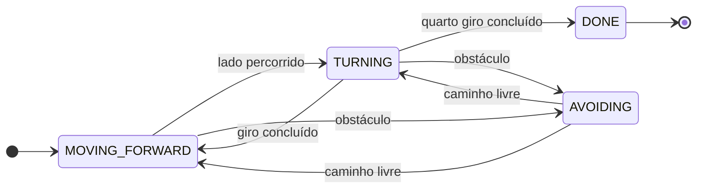
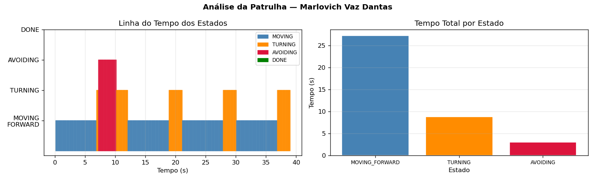

# Agente de Patrulha Autônomo em ROS 2

Um nó ROS 2 que leva um robô por um quadrado de 2 m de lado, para quando encontra um obstáculo e retoma do ponto em que parou.

Trabalho da disciplina **ESP004 — Sistemas Autônomos Robóticos** (PPGESP/IFBA, 2026.2), dos professores José Alberto Díaz Amado e João Erivando Soares Marques.
Autor: Marlovich Vaz Dantas ([@marlovich](https://github.com/marlovich)).

## Como funciona

O `PatrolNode` é uma máquina de quatro estados que publica velocidades em `/cmd_vel` a cada 100 ms e escuta o tópico `/obstaculo`.



Sem odometria, o nó estima o progresso somando os comandos que ele mesmo enviou. Enquanto está parado, essa soma não cresce; por isso, ao voltar de uma parada, ele termina só o que faltava do lado ou do giro.

| Parâmetro | Valor |
|---|---|
| Velocidade linear | 0,3 m/s |
| Velocidade angular | 0,785 rad/s |
| Lado do quadrado | 2,0 m |
| Frequência de controle | 10 Hz |

## Resultado

Execução de 14/11/2026, com um obstáculo simulado entre 7 s e 10 s.



O robô completou os 4 lados em 39,0 s, com 1 parada: 27,2 s andando, 8,8 s girando e 3,0 s parado. O trecho interrompido levou exatamente 3,0 s a mais que os outros, sinal de que nada foi refeito na retomada.

A [apresentação técnica](docs/APRESENTACAO.md) explica as escolhas do projeto e analisa esses números.

## O que ainda falta

- **Teste em simulador ou robô.** Até aqui o nó foi validado pelos estados e comandos que produz, não por uma trajetória medida.
- **Giros exatos.** Por um arredondamento do controle a 10 Hz, cada giro comanda 94,5° em vez de 90°. A causa e a correção estão na apresentação.
- **Odometria.** Usar `/odom` no lugar da soma de comandos.

## Como rodar

Requisitos: Ubuntu 24.04, ROS 2 Jazzy em `/opt/ros/jazzy` e JupyterLab.

```bash
git clone git@github.com:marlovich/esp004-patrulha.git
cd esp004-patrulha
jupyter lab
```

O Jupyter precisa de um kernel que carregue o ROS 2 antes do Python. Para criá-lo:

```bash
mkdir -p ~/.local/share/jupyter/kernels/ros2jazzy
cat > ~/.local/share/jupyter/kernels/ros2jazzy/kernel.json << 'EOF'
{
  "argv": ["bash", "-c",
    "source /opt/ros/jazzy/setup.bash && exec python3 -m ipykernel_launcher -f {connection_file}"],
  "display_name": "Python 3 (ROS2 Jazzy)",
  "language": "python",
  "env": { "ROS_DOMAIN_ID": "0" }
}
EOF
```

Com o kernel **Python 3 (ROS2 Jazzy)** selecionado, rode `nb01_ambiente_setup.ipynb` para conferir o ambiente e depois `nb04_atividade_avaliativa.ipynb`.

## Estrutura

```
notebooks/   nb01 a nb03: material de apoio da disciplina
             nb04: o PatrolNode e a análise da sessão
             resultados/: figura gerada pelo nb04
docs/        apresentação técnica e a simulação da trajetória
models/      reservado para modelos treinados
bags/        reservado para gravações rosbag2
```

Os commits seguem o padrão [Conventional Commits](https://www.conventionalcommits.org/).
