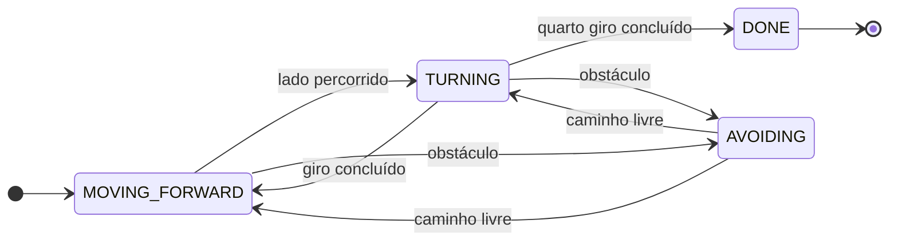
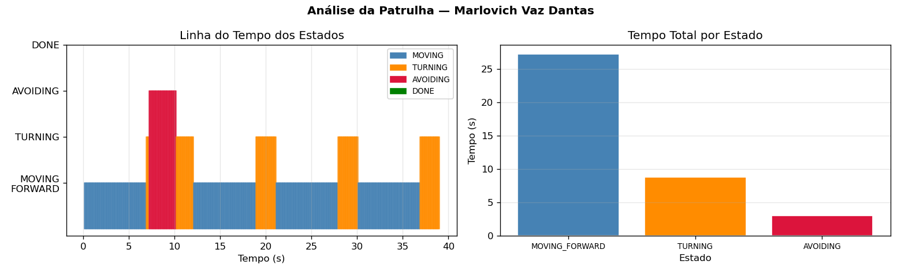
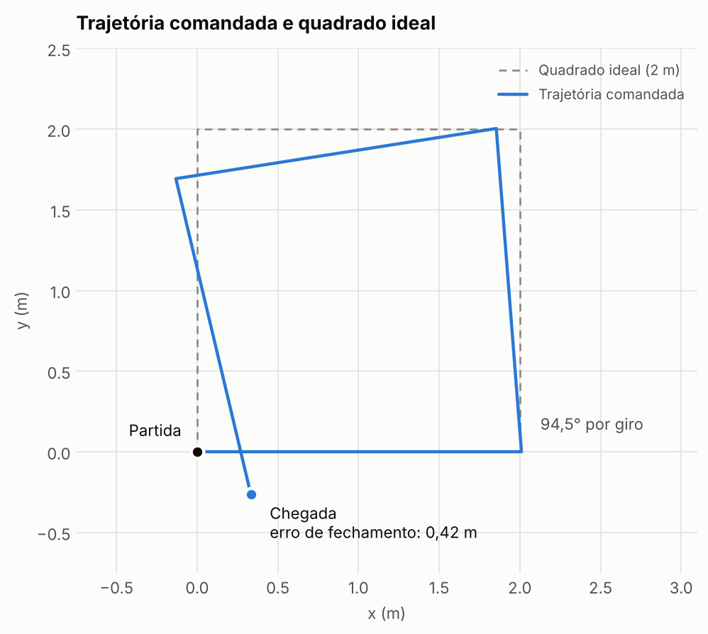

# Agente de Patrulha Autônomo: apresentação técnica

**ESP004 — Sistemas Autônomos Robóticos · PPGESP/IFBA · 2026.2**
Marlovich Vaz Dantas · novembro de 2026

Este texto conta como o `PatrolNode` foi pensado, o que ele faz bem e onde ainda erra. Para rodar o projeto, veja o [README](../README.md); o código está em [`nb04_atividade_avaliativa.ipynb`](../notebooks/nb04_atividade_avaliativa.ipynb).

## O problema

O robô precisa percorrer um quadrado de 2 m de lado, parar quando surgir um obstáculo e continuar quando o caminho for liberado. O nó publica velocidades em `/cmd_vel` a 10 Hz e escuta o tópico `/obstaculo`.

Andar e girar é a parte fácil. A dificuldade está na retomada: depois de uma parada, o robô deve continuar de onde estava, sem refazer o lado ou o giro que foi interrompido.

## A solução

Quatro estados organizam a missão:

Como não há odometria, o nó estima o quanto já andou somando, a cada ciclo, o comando que ele mesmo enviou no ciclo anterior:

$$
d_k = d_{k-1} + v_{k-1}\,\Delta t_k
\qquad
\theta_k = \theta_{k-1} + \omega_{k-1}\,\Delta t_k
$$

É essa escolha que resolve a retomada. Parado, o robô envia velocidade zero, então a soma simplesmente não cresce, dure a parada o quanto durar. Ao voltar, falta percorrer só o que faltava antes. A alternativa de cronometrar o tempo no estado não funciona aqui, porque o cronômetro é zerado na volta e o trecho recomeça.

## O que o controle a 10 Hz custa

O nó só percebe que terminou um trecho no primeiro ciclo em que a soma passa do limite. Isso dá um número inteiro de ciclos por trecho:

$$
n_{\text{lado}} = \left\lceil \frac{2{,}0}{0{,}3 \times 0{,}1} \right\rceil = 67
\qquad
n_{\text{giro}} = \left\lceil \frac{\pi/2}{0{,}785 \times 0{,}1} \right\rceil = 21
$$

Somando um ciclo de transição por trecho e os 3 s de parada, a missão deveria durar 4 × (68 + 22) × 0,1 + 3,0 = 39,0 s, contra 37,7 s se o tempo fosse contínuo.

## Resultados

Execução de 14/11/2026. O obstáculo aparece entre 7 s e 10 s, logo no início do primeiro giro.

| | Previsto | Medido |
|---|---:|---:|
| Tempo andando | 27,2 s | 27,2 s |
| Tempo girando | 8,8 s | 8,8 s |
| Tempo parado | 3,0 s | 3,0 s |
| Duração total | 39,0 s | 39,0 s |

O robô completou os 4 lados com 1 parada, e os tempos medidos coincidem com a conta acima.

A retomada também se confirma nos registros. Um ciclo de giro mais lado leva 9,0 s; o ciclo interrompido levou 12,0 s, ou seja, os mesmos 9,0 s mais os 3,0 s de parada. Nada foi refeito.

## Onde a solução ainda erra

O arredondamento para cima pesa nos giros. A velocidade de 0,785 rad/s fica um pouco abaixo de π/4, então 20 ciclos somam 1,5700 rad, a 0,0008 rad dos 90°. O nó gira mais um ciclo inteiro e cada curva sai com 94,5°.

A figura mostra o efeito acumulado: o quadrado não fecha. O robô terminaria a 0,42 m da partida e 17,8° fora da orientação inicial. Ela vem de uma simulação ([`trajetoria_comandada.py`](figuras/trajetoria_comandada.py)) que supõe um robô ideal, que obedece exatamente aos comandos.

A correção é pequena: no último ciclo de cada trecho, enviar só a velocidade necessária para completar o que falta.

$$
\omega_k = \min\left(\omega,\ \frac{\pi/2 - \theta_k}{T}\right)
$$

## Limites deste trabalho

- **Não foi testado em simulador nem em robô.** O experimento registra os estados e os comandos do nó. Ficam validadas a lógica, a temporização e a retomada; a trajetória física, não.
- **A malha é aberta.** O nó confia nos próprios comandos. Com `/odom`, os limites passariam a depender do que o robô de fato percorreu.
- **O robô só espera.** Diante do obstáculo ele para até o caminho abrir; não tenta contornar.

## Conclusão

O `PatrolNode` cumpre a missão e retoma sem repetir trechos, graças à decisão de somar os comandos enviados em vez de cronometrar o estado. A conta dos ciclos explica exatamente os tempos medidos e também revela o defeito dos giros de 94,5°. Corrigir esse arredondamento e fechar a malha com odometria são os próximos passos, antes de levar o nó ao Gazebo.
